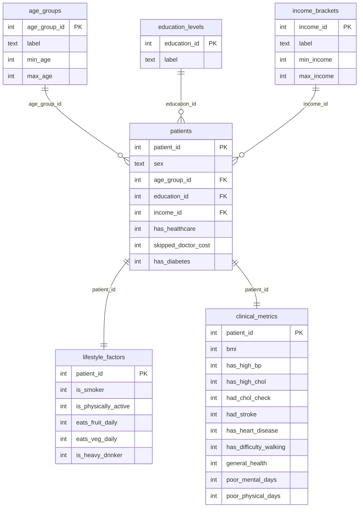

# Type 2 Diabetes Risk Predictor

A web app that estimates a person's risk of type 2 diabetes from self-reported
health and lifestyle information, built on a SQL data layer.

> **Disclaimer:** This is an educational portfolio project. It is not a medical
> device and is not a substitute for professional medical advice.

**Status:** work in progress.

## Planned architecture

1. **Data** - CDC Diabetes Health Indicators dataset (BRFSS 2015, ~253,000 survey responses).
2. **SQL layer** - normalised SQLite database, feature engineering in SQL views, analysis queries.
3. **Model** - logistic regression (baseline) compared with XGBoost; evaluated on ROC-AUC, precision-recall and calibration.
4. **Web app** - Streamlit form that returns a risk level and logs anonymous predictions to PostgreSQL.

## Database schema

The raw data is one flat CSV. [`sql/01_schema.sql`](sql/01_schema.sql) splits it into
three tables linked by `patient_id`, plus three lookup tables that turn the survey's
coded answers into readable labels. Yes/no and numeric columns have `CHECK` constraints on their allowed values.



[`src/build_database.py`](src/build_database.py) loads the data and then validates it:
each table holds 253,680 rows, there are no foreign key violations, and joining the
three tables back together reproduces every value in the original CSV.

## Feature engineering in SQL

[`sql/02_views.sql`](sql/02_views.sql) builds the model's features inside the database
rather than in Python:

| View | Purpose |
|---|---|
| `v_patient_profile` | One readable row per patient, with codes replaced by labels |
| `v_engineered_features` | New features built with `CASE WHEN` and arithmetic |
| `v_summary_by_age_band` | Summary statistics for four life-stage age bands |
| `training_features` | The single view the model reads from (`SELECT * FROM training_features`) |

Engineered features: WHO BMI category, life-stage age band, income band, college
graduate flag, frequent physical and mental distress (14 or more unhealthy days in 30),
a count of cardiovascular conditions (0-4) and a count of healthy habits (0-5).

The diabetes rate rises steadily with the number of cardiovascular conditions
(high blood pressure, high cholesterol, heart disease, stroke):

| Conditions | Patients | Diabetes rate |
|---|---|---|
| 0 | 97,968 | 3.7% |
| 1 | 81,002 | 12.2% |
| 2 | 57,010 | 26.5% |
| 3 | 15,217 | 36.4% |
| 4 | 2,483 | 47.4% |

## Analysis in SQL

[`sql/03_analysis.sql`](sql/03_analysis.sql) holds eight queries, and
[`docs/analysis_results.md`](docs/analysis_results.md) holds their full output.

| Query | Question | SQL technique |
|---|---|---|
| Q1 | What does the population look like overall? | Aggregate functions |
| Q2 | How does the diabetes rate differ by age and sex? | Conditional aggregation (pivot) |
| Q3 | How much does risk rise with BMI, relative to a healthy weight? | CTEs with a baseline |
| Q4 | How does the rate change from one age group to the next? | `LAG` and a running `SUM` |
| Q5 | Which yes/no factors matter most? | `UNION ALL` and odds ratios |
| Q6 | How do income and education combine? | Joins, `HAVING`, `RANK` |
| Q7 | Which BMI category is riskiest within each age band? | `ROW_NUMBER` with `PARTITION BY` |
| Q8 | How concentrated is diabetes among people with heart conditions? | Running totals |

Key findings:

- **Blood pressure is the strongest single factor.** People with high blood pressure have
  5 times the odds of diabetes (24.4% against 6.0%).
- **Risk climbs with every BMI category.** Compared with a healthy weight, the rate is 2 times
  higher when overweight and 5.9 times higher in obese class III.
- **Cases are concentrated.** The 29.5% of people with two or more cardiovascular conditions
  account for 61.7% of all diabetes cases.
- **Income and education compound.** The rate is 32.0% for low-income respondents who left
  school by grade 8, and 7.9% for high-income college graduates.
- **The gap between men and women widens with age,** from under 1 point below 50 to 4.9 points at 65 and over.

These are associations in survey data, not causes.

## Repository layout

| Folder       | Contents                                                   |
|--------------|------------------------------------------------------------|
| `data/`      | Raw CSV and the SQLite database (not committed)            |
| `docs/`      | Data dictionary and analysis results                       |
| `sql/`       | Schema, feature-engineering views and analysis queries     |
| `notebooks/` | Exploration and model evaluation notebooks                 |
| `src/`       | Python scripts: load the database, train the model         |
| `models/`    | Saved model pipeline (`.joblib`)                           |
| `app/`       | Streamlit web app                                          |

## Setup

```bash
py -m venv .venv
.venv\Scripts\activate
pip install -r requirements.txt
python src/download_data.py
python src/build_database.py
python src/run_analysis.py
```

## Progress

- [x] Step 1 - project setup
- [x] Step 2 - data download and exploration ([notebook](notebooks/01_data_exploration.ipynb), [data dictionary](docs/data_dictionary.md))
- [x] Step 3 - database schema and load ([schema](sql/01_schema.sql), [build script](src/build_database.py))
- [x] Step 4 - feature engineering in SQL ([views](sql/02_views.sql))
- [x] Step 5 - analysis queries ([queries](sql/03_analysis.sql), [results](docs/analysis_results.md))
- [ ] Step 6 - model training
- [ ] Step 7 - Streamlit app
- [ ] Step 8 - prediction logging
- [ ] Step 9 - deployment
