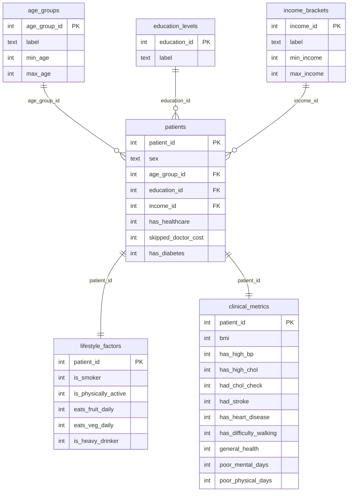
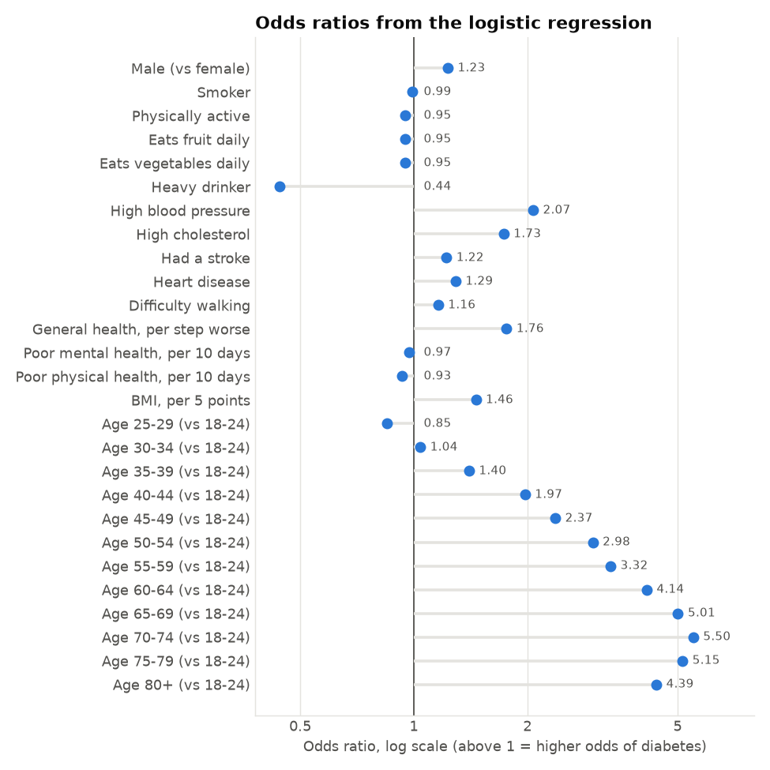

# Type 2 Diabetes Risk Predictor

A web app that estimates a person's risk of type 2 diabetes from self-reported
health and lifestyle information, built on a SQL data layer.

> **Disclaimer:** This is an educational portfolio project. It is not a medical
> device and is not a substitute for professional medical advice.

**Status:** work in progress.

## Planned architecture

1. **Data** - CDC Diabetes Health Indicators dataset (BRFSS 2015, ~253,000 survey responses).
2. **SQL layer** - normalised SQLite database, feature engineering in SQL views, analysis queries.
3. **Model** - logistic regression (baseline) compared with XGBoost; evaluated on ROC-AUC, precision-recall and calibration.
4. **Web app** - Streamlit form that returns a risk level and logs anonymous predictions to PostgreSQL.

## Database schema

The raw data is one flat CSV. [`sql/01_schema.sql`](sql/01_schema.sql) splits it into
three tables linked by `patient_id`, plus three lookup tables that turn the survey's
coded answers into readable labels. Yes/no and numeric columns have `CHECK` constraints on their allowed values.



[`src/build_database.py`](src/build_database.py) loads the data and then validates it:
each table holds 253,680 rows, there are no foreign key violations, and joining the
three tables back together reproduces every value in the original CSV.

## Feature engineering in SQL

[`sql/02_views.sql`](sql/02_views.sql) builds the model's features inside the database
rather than in Python:

| View | Purpose |
|---|---|
| `v_patient_profile` | One readable row per patient, with codes replaced by labels |
| `v_engineered_features` | New features built with `CASE WHEN` and arithmetic |
| `v_summary_by_age_band` | Summary statistics for four life-stage age bands |
| `training_features` | The single view the model reads from (`SELECT * FROM training_features`) |

Engineered features: WHO BMI category, life-stage age band, income band, college
graduate flag, frequent physical and mental distress (14 or more unhealthy days in 30),
a count of cardiovascular conditions (0-4) and a count of healthy habits (0-5).

The diabetes rate rises steadily with the number of cardiovascular conditions
(high blood pressure, high cholesterol, heart disease, stroke):

| Conditions | Patients | Diabetes rate |
|---|---|---|
| 0 | 97,968 | 3.7% |
| 1 | 81,002 | 12.2% |
| 2 | 57,010 | 26.5% |
| 3 | 15,217 | 36.4% |
| 4 | 2,483 | 47.4% |

## Analysis in SQL

[`sql/03_analysis.sql`](sql/03_analysis.sql) holds eight queries, and
[`docs/analysis_results.md`](docs/analysis_results.md) holds their full output.

| Query | Question | SQL technique |
|---|---|---|
| Q1 | What does the population look like overall? | Aggregate functions |
| Q2 | How does the diabetes rate differ by age and sex? | Conditional aggregation (pivot) |
| Q3 | How much does risk rise with BMI, relative to a healthy weight? | CTEs with a baseline |
| Q4 | How does the rate change from one age group to the next? | `LAG` and a running `SUM` |
| Q5 | Which yes/no factors matter most? | `UNION ALL` and odds ratios |
| Q6 | How do income and education combine? | Joins, `HAVING`, `RANK` |
| Q7 | Which BMI category is riskiest within each age band? | `ROW_NUMBER` with `PARTITION BY` |
| Q8 | How concentrated is diabetes among people with heart conditions? | Running totals |

Key findings:

- **Blood pressure is the strongest single factor.** People with high blood pressure have
  5 times the odds of diabetes (24.4% against 6.0%).
- **Risk climbs with every BMI category.** Compared with a healthy weight, the rate is 2 times
  higher when overweight and 5.9 times higher in obese class III.
- **Cases are concentrated.** The 29.5% of people with two or more cardiovascular conditions
  account for 61.7% of all diabetes cases.
- **Income and education compound.** The rate is 32.0% for low-income respondents who left
  school by grade 8, and 7.9% for high-income college graduates.
- **The gap between men and women widens with age,** from under 1 point below 50 to 4.9 points at 65 and over.

These are associations in survey data, not causes.

## Model

[`src/train_model.py`](src/train_model.py) reads `training_features` from the database,
holds out 20% of patients as a test set, and compares four models.

| Model | Inputs | ROC-AUC | PR-AUC | Brier score | Average predicted risk |
|---|---|---|---|---|---|
| **Logistic regression (used in the app)** | 15 | 0.818 | 0.406 | 0.099 | 14.0% |
| Logistic regression, all features | 21 | 0.822 | 0.411 | 0.099 | 14.0% |
| Logistic regression, balanced class weights | 15 | 0.818 | 0.405 | 0.178 | 38.7% |
| XGBoost | 21 | 0.828 | 0.424 | 0.097 | 13.9% |

The actual diabetes rate in the test set is 13.9%. Five-fold cross-validation on the
training set gives a ROC-AUC of 0.822 (standard deviation 0.001).

**Why logistic regression.** XGBoost is better by about 0.01 ROC-AUC. That is too small
a gain to give up coefficients that can be read as odds ratios and shown to the user.

**Why 15 inputs.** The app model leaves out six of the 21 survey columns. Adding them all
back improves ROC-AUC by under 0.005.

- *Income, education and three access-to-care questions* are left out because a health
  tool should not need to ask for someone's income.
- *Heavy drinking* is left out because it misleads. Heavy drinkers in the survey report
  less diabetes (5.8% against 14.4%), most likely because people who are diagnosed are told
  to cut down. A model that used it gave heavy drinkers an odds ratio of 0.44, which more
  than halved the risk it showed them.

**Why no class weighting.** Only 13.9% of patients have diabetes. Balancing the classes
leaves the ranking unchanged (ROC-AUC 0.818) but makes the model predict an average risk
of 38.7%, almost three times the truth. The app shows people a probability, so the
probability has to be honest.


### Risk levels

The app turns the predicted probability into three levels. On the test set:

| Level | Predicted risk | Share of people | Actual diabetes rate | Share of all cases |
|---|---|---|---|---|
| Low | Under 10% | 56.1% | 3.8% | 15.1% |
| Moderate | 10% to 25% | 25.1% | 17.8% | 32.1% |
| High | 25% or more | 18.8% | 39.2% | 52.8% |

### Odds ratios

Each value is the effect of one factor with the other fourteen held constant.



These are smaller than the single-factor odds ratios in the SQL analysis. High blood
pressure falls from 5.0 on its own to 2.1 in the model, because people with high blood
pressure also tend to be older and heavier, and the model credits those separately.

Smoking and diet have almost no effect once the other factors are accounted for. That
describes this survey and should not be read as advice.

## Web app

[`app/app.py`](app/app.py) is a Streamlit app. It asks 15 questions and returns:

- a risk level (low, moderate or high) and the estimated probability
- a chart of which answers raise or lower that person's estimate, compared with the
  average survey respondent
- an "About the model" tab with the accuracy figures, odds ratios and limitations

No answer is pre-selected for the yes/no questions, so the app never assumes one. The
prediction logic lives in [`app/risk_model.py`](app/risk_model.py), separate from the
interface, and is covered by tests.

```bash
streamlit run app/app.py
python -m pytest
```

### Prediction logging

The app writes back to SQL. When a visitor ticks the consent box, their answers and
result are inserted into a `user_predictions` table in PostgreSQL, defined in
[`sql/04_user_predictions.sql`](sql/04_user_predictions.sql). A "Usage" tab reads the
table back with a `GROUP BY` query and shows totals only.

Privacy choices:

- **Opt-in.** The consent box is never pre-ticked, and nothing is stored without it.
- **Minimal.** Only the 15 model inputs and the result are stored. There is no name,
  IP address or session ID, and age is kept as a five-year band, not an exact age.
  Height and weight are not stored, only the BMI worked out from them.
- **Fail-safe.** If the database is unreachable the visitor still gets their result.

With no database configured, the app logs to a local SQLite file, so it runs on any
machine with no setup. To use a hosted database, copy
[`.streamlit/secrets.toml.example`](.streamlit/secrets.toml.example) to
`.streamlit/secrets.toml`, paste in the connection string, and run
`python src/setup_prediction_db.py` to create the table.

## Repository layout

| Folder       | Contents                                                   |
|--------------|------------------------------------------------------------|
| `data/`      | Raw CSV and the SQLite database (not committed)            |
| `docs/`      | Data dictionary, analysis results and model figures        |
| `sql/`       | Schema, feature-engineering views and analysis queries     |
| `notebooks/` | Data exploration notebook                                  |
| `src/`       | Python scripts: load the database, train the model         |
| `models/`    | Saved model pipeline (`.joblib`) and its metrics           |
| `app/`       | Streamlit web app                                          |
| `tests/`     | Tests for the prediction logic and the app                 |

## Setup

```bash
py -m venv .venv
.venv\Scripts\activate
pip install -r requirements.txt
python src/download_data.py
python src/build_database.py
python src/run_analysis.py
python src/train_model.py
```

## Progress

- [x] Step 1 - project setup
- [x] Step 2 - data download and exploration ([notebook](notebooks/01_data_exploration.ipynb), [data dictionary](docs/data_dictionary.md))
- [x] Step 3 - database schema and load ([schema](sql/01_schema.sql), [build script](src/build_database.py))
- [x] Step 4 - feature engineering in SQL ([views](sql/02_views.sql))
- [x] Step 5 - analysis queries ([queries](sql/03_analysis.sql), [results](docs/analysis_results.md))
- [x] Step 6 - model training ([script](src/train_model.py), [model details](models/model_info.json))
- [x] Step 7 - Streamlit app ([app](app/app.py), [tests](tests/))
- [x] Step 8 - prediction logging ([table](sql/04_user_predictions.sql), [logging code](app/prediction_log.py))
- [ ] Step 9 - deployment
